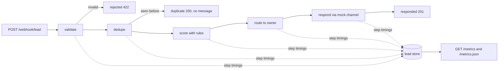

# speed-to-lead

A new lead that waits an hour for a reply has usually already called someone else.
Small teams lose those leads because intake, triage and the first reply are manual and nobody measures how long they take.

## What it does

A small TypeScript service with one webhook and one metrics page.

1. **Receive**: `POST /webhook/lead` takes a JSON lead (optional shared secret header).
2. **Validate**: name plus a usable phone or email; fields are trimmed and normalized.
3. **Dedupe**: the same phone or email inside a time window is marked a duplicate and gets no second message.
4. **Score**: fixed, readable rules in `src/score.ts`. Every score comes with the list of rules that fired.
5. **Route**: ordered rules pick an owner (out of area, specialist, generalist, fallback) and record the reason.
6. **Respond**: a first reply goes out through a mock channel, with one retry on failure.
7. **Measure**: every step is timed. `GET /metrics` shows median and p90 time to first response against a 60 second target.

No runtime dependencies. Node's built-in `http` module, in-memory storage, and a mock channel, so everything runs offline with no keys.

## Architecture



| File | Role |
| --- | --- |
| `src/server.ts` | HTTP routes and startup |
| `src/pipeline.ts` | Runs the steps in order, times each one, stores the record |
| `src/validate.ts`, `src/dedupe.ts` | Input checks and duplicate detection |
| `src/score.ts`, `src/route.ts` | Scoring rules and owner assignment |
| `src/channel.ts` | Channel interface and the mock implementation |
| `src/metrics.ts` | Median, p90, summary and the HTML page |
| `src/config.ts` | Defaults (owners, service area, keywords) and env parsing |

## Run it

```bash
npm install
npm start
```

Then, in a second terminal:

```bash
curl -X POST http://localhost:3000/webhook/lead -H "content-type: application/json" -d '{"name":"Alex Sample","phone":"555-555-0101","service":"kitchen","postalCode":"00012","message":"Leak under the sink, need help today"}'
```

Open http://localhost:3000/metrics for the page, or `/metrics.json` for the same numbers as JSON.
Requires Node 20 or newer. Configuration is optional; see `.env.example` (for example `node --env-file=.env --import tsx src/server.ts`).

Response codes from the webhook: `201` responded, `200` duplicate, `422` invalid lead, `400` bad JSON, `401` bad secret, `502` channel failed after retry.

## Tests

```bash
npm test          # 34 tests, node:test, no network beyond localhost
npm run typecheck
```

The tests cover validation, each scoring and routing rule, the dedupe window, percentile math, the full pipeline with a virtual clock (retry, failure, slow send), and the HTTP server on a random local port. CI runs the same commands on Node 20 and 22.

## Demo

```bash
npm run demo
```

The simulator pushes 29 synthetic webhook calls (24 leads, 3 double submits, 2 invalid) through the real pipeline using a virtual clock and a seeded mock channel. It finishes in under a second, prints the same report every time, and writes it to [`demo/output.txt`](demo/output.txt). Excerpt:

```
lead       status      tier       service     owner           response   target
---------  ----------  ---------  ----------  --------------  ---------  ------
lead_0001  responded   warm 30    gutters     Dana Stubman    2.6 s      ok
lead_0002  responded   warm 35    gutters     Dana Stubman    1.5 s      ok
lead_0003  responded   hot 80     gutters     Dana Stubman    7.3 s      ok
lead_0004  responded   warm 45    bathroom    Robin Fixture   9.6 s      ok
lead_0005  responded   warm 55    bathroom    Sky Mockwell    6.7 s      ok
...
Summary
  leads received            29
  responded                 24
  duplicates suppressed     3
  rejected (invalid)        2
  failed                    0
  messages sent             24
  median first response     6.2 s
  p90 first response        11.4 s
  slowest first response    86.1 s
  within 60.0 s target      96%
```

All names, phone numbers, emails and postal codes in this repo are invented.

## Where this pattern runs

This is a cleaned-up, generic version of an intake pattern drawn from systems that run two small service companies day to day. The production versions sit behind real web forms and messaging providers; this repo keeps the shape (validate, dedupe, score, route, respond, measure) and replaces everything specific with synthetic defaults.

## Limitations

- Storage is in memory. Leads, dedupe keys and metrics are lost on restart, and it only works as a single process.
- The only channel is a mock. No SMS or email is sent. The latency in the demo is simulated, so the demo numbers show the measurement working, not real provider speed.
- The webhook processes the lead inline and replies when the first response is sent. A slow provider means a slow webhook reply; a production version would acknowledge first and work from a queue.
- Time to first response starts when the webhook is received. Any delay between the person submitting a form and the webhook arriving is not counted.
- Routing load is a simple count since startup. There are no business hours, calendars, or owner availability.
- Scoring is a short fixed rule list with keyword matching. It is transparent, not smart.
- Phone validation assumes 10 digit North American numbers.
- The shared secret header is basic protection. There is no signature check, rate limiting or replay protection.

License: MIT, see the LICENSE file.
