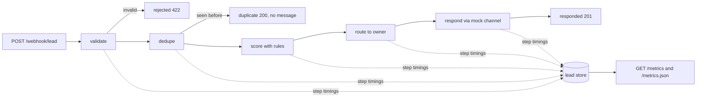

# speed-to-lead

**The problem:** someone fills in your contact form, nobody replies for an hour, and by then they have called another company.
In a small service business (trades, repairs, clinics, agencies) the first reply is usually manual, and nobody measures how long it takes.

**What this does:** the moment a lead arrives it is checked, scored, assigned to the right person and sent a first reply.
Every lead gets a time-to-first-reply measurement, and a metrics page shows how often you hit a 60 second target.

- A real person with a usable phone or email gets an immediate "we have it, here is who will call you" message.
- Double submits get one reply, not two. Junk with no contact details is rejected and logged.
- Urgent, high value, in-area leads are flagged hot and go to the right owner, with the reasons written down.
- You see median and p90 reply time, the slowest reply, and the share inside the target.

**What it is, honestly:** a working reference build, not a deployed product. It runs offline with a mock message channel, so no SMS or email is actually sent and the reply times in the demo are simulated. The 60 seconds is a target the code measures against, not a guarantee. See [Limitations](#limitations).

Built in TypeScript on Node's built-in `http` module, with no runtime dependencies and 39 tests.

## What you will see

`npm run demo` pushes 29 synthetic webhook calls through the real pipeline. Lines below are copied from its output ([full report](demo/output.txt)):

```
lead       status      tier       service     owner           response   target
---------  ----------  ---------  ----------  --------------  ---------  ------
lead_0003  responded   hot 80     gutters     Dana Stubman    7.3 s      ok
lead_0006  rejected                                                      phone or email is required
lead_0009  responded   hot 65     gutters     Dana Stubman    6.8 s      ok
lead_0010  duplicate              gutters                                duplicate of lead_0009
lead_0014  responded   hot 80     roofing     Sky Mockwell    86.1 s     MISSED

Why lead_0003 scored 80 (hot):
  +15  has_phone: Phone number provided
   +5  has_email: Email provided
  +25  urgent_language: Message uses urgent wording
  +15  in_service_area: Postal code is inside the service area
  +15  budget_5k_plus: Stated budget of 5000 or more
   +5  detailed_message: Message has 40 or more characters
Routed to Dana Stubman: generalist who takes hot leads
First response (sms): "Hi Alex, thanks for your gutters request. We have it. Dana Stubman will call you within 15 minutes. Reply here if anything changes."

Summary
  leads received            29
  responded                 24
  duplicates suppressed     3
  rejected (invalid)        2
  failed                    0
  messages sent             24
  median first response     6.2 s
  p90 first response        11.4 s
  slowest first response    86.1 s
  within 60.0 s target      96%
```

The response times come from a seeded random delay inside the mock channel (usually 1 to 12 seconds, about one send in ten much slower), not from a real provider. They show the measurement and the missed-target flag working. All names, phone numbers, emails and postal codes in this repo are invented.

## How it works

One webhook, one metrics page.

1. **Receive**: `POST /webhook/lead` takes a JSON lead (optional shared secret header).
2. **Validate**: a name plus at least one usable phone or email. Fields are trimmed and normalized; a mistyped second contact is dropped instead of costing the lead.
3. **Dedupe**: the same phone or email inside a time window (default 24 hours) is marked a duplicate and gets no second message. A lead whose reply failed to send is not held against a resubmit.
4. **Score**: fixed, readable rules in `src/score.ts`. Every score comes with the list of rules that fired.
5. **Route**: ordered rules pick an owner (out of area, specialist, generalist, fallback) and record the reason.
6. **Respond**: a first reply goes out through the mock channel, with one immediate retry on failure. Out-of-area leads get a "our team will follow up" reply with no named owner.
7. **Measure**: every step is timed. `GET /metrics` shows median and p90 time to first response against the target. A reply that never went out counts as a miss.

## Architecture



| File | Role |
| --- | --- |
| `src/server.ts` | HTTP routes and startup |
| `src/pipeline.ts` | Runs the steps in order, times each one, stores the record |
| `src/validate.ts`, `src/dedupe.ts` | Input checks and duplicate detection |
| `src/score.ts`, `src/route.ts` | Scoring rules and owner assignment |
| `src/channel.ts` | Channel interface and the mock implementation |
| `src/metrics.ts` | Median, p90, summary and the HTML page |
| `src/config.ts` | Defaults (owners, service area, keywords) and env parsing |

## Run it

Requires Node 20 or newer (checked here on Node 26; CI runs 20, 22 and 24).

```bash
npm install
npm start
```

Then, in a second terminal:

```bash
curl -X POST http://localhost:3000/webhook/lead -H "content-type: application/json" -d '{"name":"Alex Sample","phone":"555-555-0101","service":"kitchen","postalCode":"00012","message":"Leak under the sink, need help today"}'
```

That returns `201` with the full record: the normalized lead, a score of 75 (hot) with the four rules that fired, the owner and reason, the mock message, and per-step timings. With the default 150 ms mock latency the whole call takes about 0.16 seconds.

Open http://localhost:3000/metrics for the page, or `/metrics.json` for the same numbers as JSON.
Configuration is optional; see `.env.example`. To use a `.env` file, start with `node --env-file=.env --import tsx src/server.ts` (Node 20.6 or newer).

Response codes from the webhook: `201` responded, `200` duplicate, `422` invalid lead, `400` bad JSON, `401` bad secret, `502` channel failed after retry.

## Tests

```bash
npm test          # 39 tests, node:test, no network beyond localhost
npm run typecheck
npm run demo      # rewrites demo/output.txt, same report every run
```

The tests cover validation, each scoring and routing rule, the dedupe window, percentile math, the full pipeline with a virtual clock (retry, failure, resubmit after failure, slow send), and the HTTP server on a random local port. CI runs the same three commands.

## Where this pattern comes from

The shape (validate, dedupe, score, route, respond, measure) is the author's generic take on lead intake for small service businesses. No production code, customer data or real configuration is in this repo, and this code has never been connected to a live form or messaging provider.

## Limitations

What is mocked or never run live:

- **No message is ever sent.** The only channel is `MockChannel`, which records messages in memory. There is no Twilio, SendGrid or other provider code, and `CHANNEL_MODE` accepts only `mock`. A real channel has to be written against the `Channel` interface in `src/types.ts`.
- **Reply times are simulated.** Demo latency is a seeded random number; the server default is a fixed 150 ms sleep. Nothing here measures a real provider, and "sent" means the mock returned, not that anyone received anything.
- **Never run against a live service.** No real form, CRM, phone number or inbox has been wired to this code. The only HTTP traffic it has seen is `curl` and the test suite on localhost.
- **No deployment.** No Dockerfile, hosting config, TLS or process manager.

What the design does not do:

- Storage is in memory. Leads, dedupe keys and metrics are lost on restart, memory grows with every lead, and it only works as a single process.
- The webhook processes the lead inline and replies when the first response is sent. A slow provider means a slow webhook reply; a production version would acknowledge first and work from a queue.
- Time to first response starts when the webhook is received. Any delay between the person submitting a form and the webhook arriving is not counted.
- The reply promises a callback ("within 15 minutes" for hot leads). Nothing notifies the owner or checks that the call happened, and there are no business hours, calendars or owner availability. Routing load is a simple count since startup.
- The retry is immediate, once, with no backoff. A failed lead returns `502` and is recorded; nothing retries it later or alerts anyone.
- Scoring is a short fixed rule list with substring keyword matching ("not urgent" still matches "urgent"). It is transparent, not smart.
- Phone validation assumes 10 digit North American numbers. Email is checked by shape only.
- The shared secret header is basic protection. There is no signature check, rate limiting or replay protection, and the metrics page has no login.
- No opt-out or consent handling for SMS or email, which a real deployment needs.

License: MIT, see the LICENSE file.
